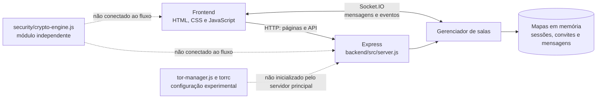
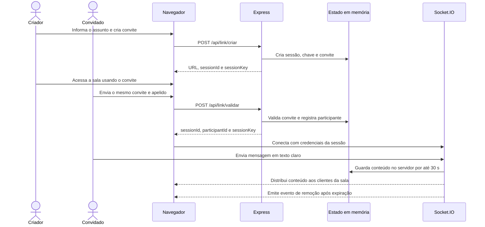

# AVAchat SHADOW

**Aplicação experimental de salas temporárias de comunicação em tempo real**

O AVAchat SHADOW é uma aplicação web baseada em Node.js, Express e Socket.IO. Ela permite criar uma sala, compartilhar um convite e trocar mensagens em tempo real. O projeto também contém um módulo experimental de criptografia e arquivos de configuração para uso com Tor.

> **Estado de segurança:** este repositório ainda não implementa criptografia ponta a ponta no fluxo de mensagens. Embora exista código AES-256-GCM em `backend/src/security/crypto-engine.js`, o chat atual envia as mensagens em texto claro ao servidor e não chama esse módulo. Não use a aplicação para informações sensíveis ou como sistema de segurança de produção.

## Visão geral

- Interface web para iniciar ou acessar uma conversa.
- Convites temporários associados a sessões mantidas em memória.
- Comunicação em tempo real via Socket.IO.
- Remoção programada de mensagens armazenadas no processo do servidor.
- Módulo independente com uma implementação experimental de AES-256-GCM.
- Componentes e configuração de Tor presentes no repositório, sem integração operacional completa com o servidor principal.

## Estrutura do projeto

```text
.
├── backend/
│   ├── package.json
│   └── src/
│       ├── server.js
│       ├── server-simple.js
│       ├── network/
│       │   └── tor-manager.js
│       └── security/
│           └── crypto-engine.js
├── public/
│   ├── index.html
│   ├── entrar.html
│   ├── chat.html
│   └── assets/
│       ├── css/style.css
│       └── js/script.js
├── logs/                 # Saída local/runtime
├── tor/data/             # Estado local do Tor; não compartilhar chaves privadas
└── README.md
```

`backend/src` contém o código da aplicação; `public` contém somente arquivos servidos ao navegador. `logs` e `tor/data` são diretórios de execução/configuração local, não parte do código-fonte da aplicação.

## Mapa da arquitetura



### Componentes

| Componente | Responsabilidade atual |
| --- | --- |
| `public/index.html` | Interface para iniciar uma conversa e gerar um convite. |
| `public/entrar.html` | Interface para inserir um convite e escolher um apelido. |
| `public/chat.html` | Interface da sala de conversa. |
| `public/assets/js/script.js` | Chamadas HTTP, armazenamento das credenciais da sala em `sessionStorage` e eventos do Socket.IO. |
| `public/assets/css/style.css` | Estilos da aplicação. |
| `backend/src/server.js` | Servidor principal: páginas, API, autenticação do Socket.IO, salas e ciclo de vida das mensagens. |
| `backend/src/server-simple.js` | Variante alternativa sem configuração Tor integrada; também mantém estado em memória. |
| `backend/src/security/crypto-engine.js` | Protótipo isolado de funções criptográficas; não é usado pelo fluxo de mensagens atual. |
| `backend/src/network/tor-manager.js` | Gerenciador experimental que pode iniciar um processo Tor, mas não é iniciado pelo servidor principal. |
| `tor/data/torrc` | Arquivo de configuração Tor existente no repositório; contém caminhos específicos do ambiente original. |

## Fluxo de uma conversa



> **Atenção ao convite:** a rota `/api/link/validar` marca o link como utilizado no primeiro acesso. No fluxo atual, o criador também usa essa rota para entrar na sala; portanto, o mesmo link não funciona como um convite reutilizável para criador e convidado. Esse comportamento precisa ser revisto antes de considerar o fluxo de convite pronto.

## O que acontece com uma mensagem

1. O navegador envia o texto digitado no evento Socket.IO `message`.
2. O servidor recebe o texto, armazena-o no mapa `messageStore` e o retransmite para os participantes da sala.
3. O servidor programa a remoção do item após 30 segundos; a interface inicia a remoção visual antes disso.
4. O conteúdo também é incluído em uma saída de log do servidor.

A expiração é uma limpeza temporária de memória, não uma garantia de apagamento seguro. Ela não apaga cópias, capturas de tela, registros externos ou dados mantidos por ferramentas de monitoramento.

## Criptografia: implementação atual

O módulo `backend/src/security/crypto-engine.js` contém uma rotina que aplica AES-256-GCM usando `node:crypto`. Isso não significa que as mensagens do produto estejam criptografadas: o módulo não é importado no servidor ou no cliente, e o evento de chat transporta o texto original.

Outras funções do módulo também são protótipos, não garantias de segurança:

- A rotina chamada de XChaCha20-Poly1305 usa AES-256-CBC como fallback, sem autenticação própria nessa camada.
- A operação RSA opcional apenas adiciona uma entrada ao log; não cifra nem assina dados.
- `signMessage` calcula um hash, mas não gera uma assinatura digital com chave privada.
- `deriveKey` usa SHA-512 com concatenação simples; não implementa Argon2id nem PBKDF2.
- O fluxo real cria `sessionKey` por meio de `Math.random()` e a entrega pelo servidor aos clientes. Ela não é uma chave de sessão criptográfica gerada por um protocolo de acordo de chaves.

**Conclusão:** no estado atual, não há criptografia ponta a ponta, autenticação criptográfica de mensagens ou sigilo futuro (forward secrecy) implementados no chat.

## Transporte e Tor

O servidor principal escuta em `0.0.0.0:3000`. A configuração de Express inclui Helmet, compressão, CORS e limite geral de requisições. Socket.IO aceita origem `*` e usa WebSocket ou polling.

O `backend/src/server.js` procura o endereço `.onion` em um caminho absoluto de Windows definido no código. `backend/src/network/tor-manager.js` não é carregado pelo servidor principal, e o arquivo `tor/data/torrc` também referencia diretórios absolutos do ambiente original. Assim, a presença desses arquivos não confirma que o serviço Tor esteja ativo ou configurado corretamente neste ambiente.

O uso de um endereço `.onion` não substitui criptografia ponta a ponta: o servidor continua sendo um endpoint que recebe e processa as mensagens. Fora de uma implantação Tor funcional, o servidor não configura HTTPS por conta própria.

## Instalação e execução

### Requisitos

- Node.js e npm instalados.
- Sistema operacional compatível com as dependências do projeto.
- Para testar localmente, navegador moderno.
- Tor instalado e configurado separadamente apenas se for testar o componente Tor.

### Servidor principal

```bash
cd backend
npm install
npm start
```

A aplicação fica disponível em `http://localhost:3000`. Os atalhos de desenvolvimento e utilitário também estão definidos no pacote:

```bash
npm run dev
npm run generate-key
```

`npm run dev` utiliza Nodemon. `npm run generate-key` imprime bytes aleatórios para uso manual; a chave produzida não configura automaticamente o fluxo do chat.

### Verificação rápida

```bash
curl http://localhost:3000/api/health
```

A rota retorna o estado do processo e um timestamp. Ela não é uma verificação de segurança, de disponibilidade do Tor ou de integridade da criptografia.

## Endpoints e eventos

| Tipo | Caminho/evento | Finalidade |
| --- | --- | --- |
| `GET` | `/` | Página inicial. |
| `GET` | `/entrar` | Página para inserir o convite. |
| `GET` | `/join/:linkId` | Página da sala associada ao link. |
| `GET` | `/api/health` | Estado básico do servidor. |
| `POST` | `/api/link/criar` | Cria a sessão e retorna o convite e as credenciais. |
| `POST` | `/api/link/validar` | Valida o convite e registra um participante. |
| Socket.IO | `message` | Envia e distribui o texto da mensagem. |
| Socket.IO | `typing` | Sinaliza atividade de digitação. |
| Socket.IO | `historico` | Entrega mensagens ainda presentes na memória da sessão. |
| Socket.IO | `message-destroyed` | Notifica a remoção de uma mensagem expirada. |

## Limites e considerações operacionais

- Sessões, convites, participantes e mensagens ficam em estruturas `Map` no processo; reiniciar o servidor perde esse estado.
- A chave de sessão é transmitida pela API e armazenada no `sessionStorage` do navegador.
- O conteúdo das mensagens é recebido, retransmitido, temporariamente armazenado e parcialmente registrado pelo servidor.
- Os identificadores auxiliares são gerados com `Math.random()`, inadequado para tokens de segurança.
- A lista de bloqueio de IP e os limites também são locais ao processo e não substituem controles de borda.
- A configuração de CORS do Socket.IO permite qualquer origem.
- Há imports e configurações não utilizados no servidor, incluindo elementos relacionados a upload; o fluxo de anexos não está implementado como recurso completo.
- O comportamento do convite de uso único impede o fluxo esperado de dois participantes usando o mesmo link.

## Próximos passos recomendados

Antes de qualquer uso com dados reais, priorize:

1. Definir o modelo de ameaça e não divulgar o sistema como comunicação segura até uma revisão independente.
2. Implementar criptografia ponta a ponta no cliente, com biblioteca criptográfica mantida, autenticação de chaves e protocolo de troca de chaves revisado.
3. Remover o conteúdo das mensagens dos logs e evitar que o servidor tenha acesso ao texto em claro.
4. Substituir geradores não criptográficos por `crypto.randomBytes` ou `crypto.randomUUID` para tokens e identificadores sensíveis.
5. Corrigir o fluxo de convite e proteger a validação contra corrida, repetição e abuso.
6. Restringir origens, configurar HTTPS quando aplicável e revisar cabeçalhos, limites e configuração de proxy.
7. Remover caminhos absolutos e chaves/dados operacionais do repositório; fornecer configuração explícita por ambiente.
8. Adicionar testes para expiração, uso de convites, autorização de participantes e criptografia autenticada.

## Licença e uso

Não há informação de licença identificada neste repositório. Confirme os direitos de uso e distribuição antes de incorporar ou redistribuir o projeto.

---

**Resumo:** o AVAchat SHADOW é uma base experimental de chat temporário com integração Socket.IO. O AES-256-GCM está presente apenas em um módulo isolado; o fluxo atual de mensagens não o utiliza.